[简体中文](README.md) | **English**

# MissAV, HentaiMama, OnAir, FapFolder, Han1me
[missav](missav.ws)  [hentaimama](hentaimama.io)  [FapFolder](fapfolder.club)

[Tor VPN](https://play.google.com/store/apps/details?id=org.torproject.android)  [OnAir](check app)

<table>
  <tr>
    <td>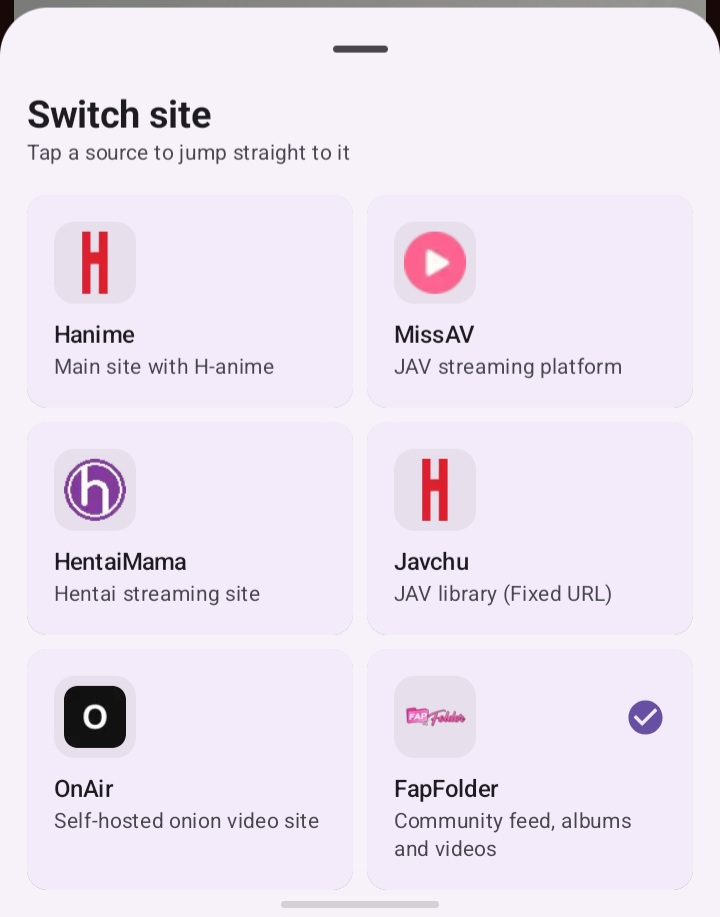</td>
    <td>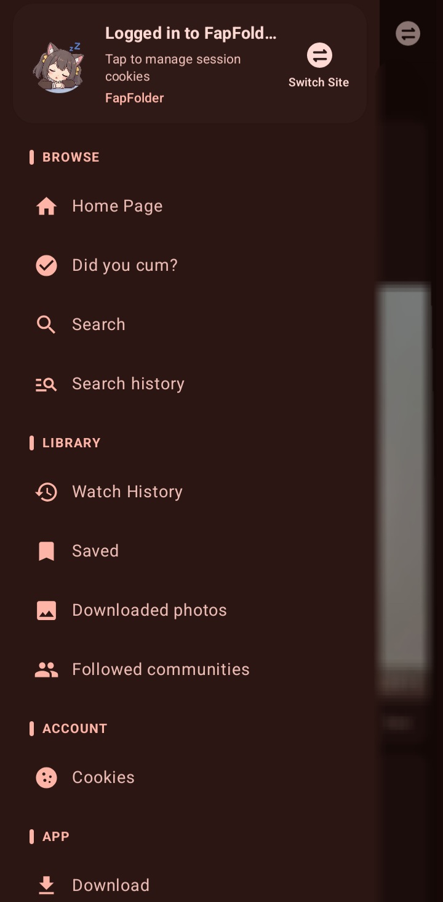</td>
    <td>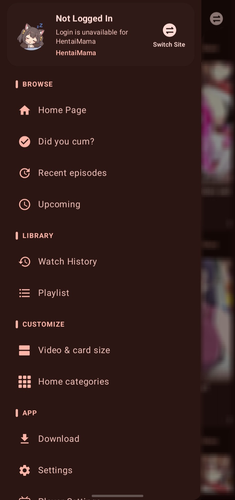</td>
  </tr>
  <tr>
    <td>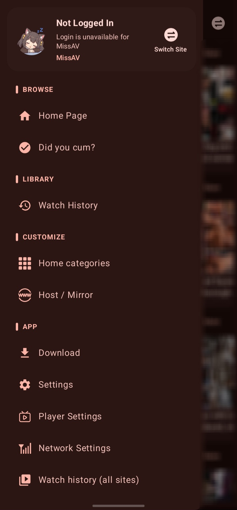</td>
    <td>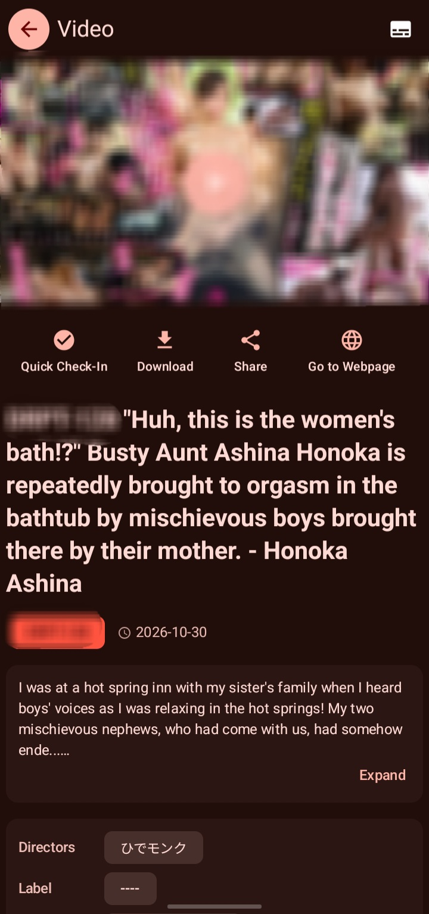</td>
    <td>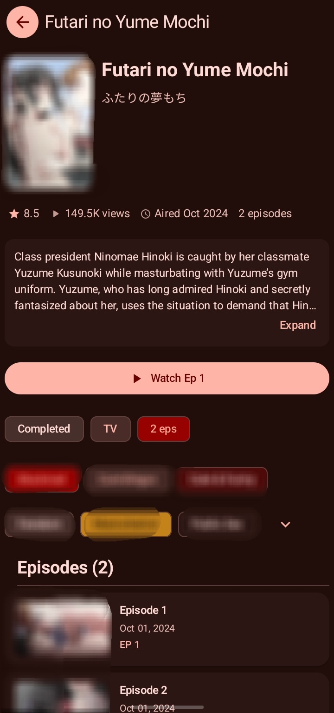</td>
  </tr>
  <tr>
    <td>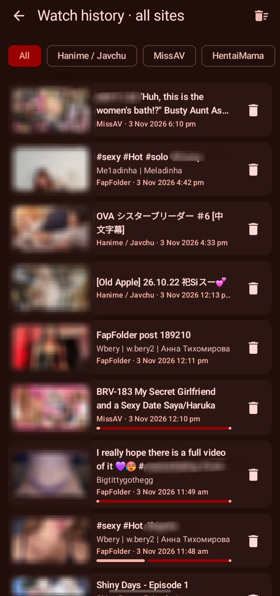</td>
    <td>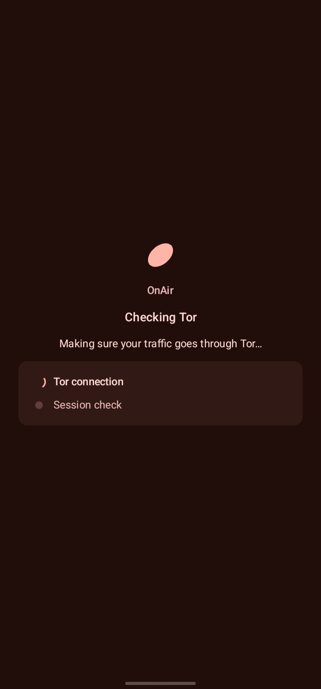</td>
    <td>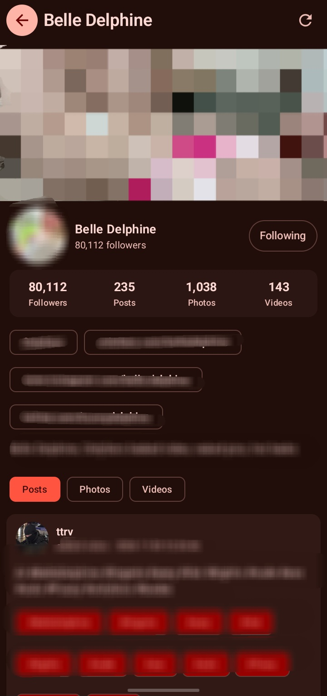</td>
  </tr>
</table>

# 🚫 Please do not promote this app on any public platform

This app does not accept any form of public promotion. If public promotion, re-posting or traffic diversion is found, the repository maintainers may archive or hide the repository at any time and delete compiled releases.

# 🌸 HANiEX

🔞 R18 warning: downloading and using this app is prohibited for anyone under 18.

HANiEX (Han1meViewer Extended) is an extended fork of Han1meViewer. The app is named **HANiEX** and its application ID (applicationId) is `com.yenaly.hani.extended`. It is an Android client written in Kotlin for browsing, searching, playing and managing publicly available hanime-related video pages. The project is built mainly on Jetpack Compose, Navigation Compose, ViewModel, StateFlow, Retrofit, Jsoup, Room, WorkManager and Media3/JZVD/MPV, and is organized around video browsing, detail playback, search, user lists, download management, comments, subscriptions, settings and privacy protection.

This app has no official website. The GitHub Releases and CI build artifacts of this fork, [lwprfs/HANiEX](https://github.com/lwprfs/HANiEX), are the only download and update channels.

## 📜 Origin and License

This project was originally forked from [YenalyLiew/Han1meViewer](https://github.com/YenalyLiew/Han1meViewer). The current direct upstream is [misaka10032w/Han1meViewer](https://github.com/misaka10032w/Han1meViewer), and this fork is [lwprfs/HANiEX](https://github.com/lwprfs/HANiEX). Thanks to all the authors for their contributions. The original project uses the [Apache License 2.0](https://www.apache.org/licenses/LICENSE-2.0).

Main changes in this fork compared with upstream:

- The app was renamed to HANiEX and its application ID changed to `com.yenaly.hani.extended` (the Kotlin source `namespace` is still `com.yenaly.han1meviewer`).
- In-app updates now come from this fork's Releases / CI, and incremental (delta) updates were added.
- New ways to install the update package: system installer, PackageInstaller and Shizuku, switchable in settings.
- CI gained Gradle caching and build optimizations, and generates delta update packages during the build.
- The Shizuku implementation is based on the extension installer of [Mihon](https://github.com/mihonapp/mihon) (Apache 2.0 / MIT).

As required by the Apache 2.0 license:

- Keep the original copyright notices.
- Include a copy of the license file.
- State the changes that were made.

Original repository: [YenalyLiew/Han1meViewer](https://github.com/YenalyLiew/Han1meViewer)

License file: [LICENSE](LICENSE)

## ⚠️ Disclaimer

This application has no affiliation, cooperation or authorization relationship with `https://hanime1.me/` or its related parties.

🔍 Data sources:

- The app only obtains information publicly displayed on the target website through ordinary network requests and HTML DOM parsing.
- The app does not access the website's backend database.
- The app does not perform injection attacks, bypass authorization or obtain non-public user private data.

⚖️ Usage restrictions:

- This app is for technical research, learning and mobile experience optimization only.
- This app does not provide any commercial service.
- Users must comply with the laws and regulations of their region and the rules of the target website.

©️ Copyright:

- The copyright of the original videos, images, text and related content belongs to `https://hanime1.me/` or the original producers and distributors.
- This app does not store copyrighted content, does not modify the original content, and does not claim ownership of any content.

🛡️ Liability exemption:

- This app does not guarantee the completeness, accuracy or timeliness of data.
- Users bear all consequences arising from the use of this app.
- This app must not be used for any illegal purpose.

If `https://hanime1.me/` considers the behavior of this app inappropriate, it can contact the maintainers through the built-in features of the GitHub repository.

🔄 Last updated: `2026-05-23`

ℹ️ You are encouraged to support the original site's content through official channels and to click ads to support the site operators.

## 💬 Discussion

Telegram group: [https://t.me/Han1meViewer](https://t.me/Han1meViewer)

## ✨ Features

- 🏠 Home browsing: home recommendations, latest uploads, category entries, preview pages and a search entry.
- 🎬 Video details: synopsis, author, tags, series videos, related recommendations, comments and sub-comments.
- ▶️ Video playback: online playback, local downloaded file playback, picture-in-picture, player engine switching, playback speed and quality selection.
- 🔍 Search: keyword search, advanced search, history, filter display and paged loading.
- 👤 User content: favorites, watch later, playlists, online history, followed authors and the creator center.
- 💬 Comments: comment sorting, viewing replies, reporting and copying share text.
- 📥 Download management: background downloads, download groups (groups can be created automatically by series name when downloading), importing local files, custom download directory and playback after download.
- 🔐 Account: login, manual cookie entry, account profile, avatar cropping, login status detection and logout.
- 🎨 Theme and settings: Material 3 theme, dynamic color, home layout, playback settings, MPV settings, download settings and network settings.
- 🕵️ Privacy protection: app lock, launcher icon disguise and manual cookie management.
- 🌐 Network helpers: Cloudflare handling, backup domains, proxy-related settings, CDN/network detection and update checks.
- 🔄 In-app updates: Release / CI update channels and incremental updates (download only a diff patch) with automatic fallback to the full APK. See "App Updates".
- 📲 Install methods: the update package can be installed with the system installer, PackageInstaller or Shizuku, similar to Mihon's extension installer setting. See "Install Methods".
- 📅 Health check-in: a built-in check-in page and a home screen widget.
- 🎯 Shared key H frames: reading, configuring and displaying built-in key frame data and shared data.
- 🗞️ Announcements: home announcement display and announcement detail dialog, together with `HanimeAnnouncementManagerWebUI` for maintaining the `announcements` node in Firebase Realtime Database.

## 🗞️ Announcement System Guide

The announcement system has two parts:

- User side: after the app starts, `MainViewModel.loadAnnouncements()` reads the `announcements` node from Firebase Realtime Database. The home page shows valid announcements and lets users open an announcement detail dialog.
- Maintenance side: `HanimeAnnouncementManagerWebUI` maintains the announcement data. It writes, updates or takes down announcements on the same `announcements` node.

The `HanimeAnnouncementManagerWebUI` directory contains two files:

- `HanimeAnnouncementManager.html`: the announcement management web page, used to add, delete, edit and query announcements and to toggle their enabled state.
- `PermitAdmin.py`: writes the `isAdmin` custom claim to Firebase Auth users, which controls who can access the admin page.

Prerequisites:

- The app must be able to access the network normally.
- The Firebase Realtime Database address configured in the project must be available.
- The announcement data under the `announcements` node must match the `Announcement` model, containing at least fields such as `title`, `content` and `isActive`.
- Announcements are sorted by `priority`, and only announcements with `isActive = true` are shown.
- The admin side needs Firebase Authentication and Realtime Database enabled.
- The admin side needs the Firebase web config parameters and an admin email and password that can sign in.
- To use `PermitAdmin.py`, you also need the Firebase Admin SDK `serviceAccountKey.json`.

Usage rules:

- The home page shows the list of valid announcements by default.
- After the user dismisses an announcement, `last_dismiss_time` is recorded, and it will not pop up automatically again within 24 hours.
- Announcement details support a title, content, publish time, image and button text.
- If an announcement has a link configured, the URL can be shown as clickable text in the content.

Admin page steps:

1. Fill in `firebaseConfig` in `HanimeAnnouncementManager.html`.
2. Fill `ADMIN_EMAIL` and `ADMIN_PASSWORD` with an admin account that can sign in to Firebase Auth.
3. Make sure the Realtime Database rules allow that admin account to read and write the `announcements` node.
4. To authorize admins in bulk, install `firebase-admin`, prepare `serviceAccountKey.json`, then run `PermitAdmin.py` and enter the target user UIDs.
5. Open the admin page to add, edit, enable, disable or delete announcements.

Announcement fields:

- `title`: announcement title.
- `content`: announcement body.
- `imageUrl`: announcement image URL, optional.
- `positiveText`: confirm button text, optional.
- `negativeText`: cancel button text, optional.
- `priority`: sort priority.
- `timestamp`: announcement timestamp, in seconds.
- `isActive`: whether it is enabled.

Maintenance tips:

- Preview a new announcement in the WebUI first, then switch it to `isActive = true`.
- Take down expired or no longer needed announcements instead of deleting them, so they can be traced back.
- Whether a higher or lower `priority` value ranks first must stay consistent with the WebUI convention to avoid confusing the order.

## 🔄 App Updates

The app checks for and downloads updates through GitHub, with no need to open the GitHub page. Updates come from this fork, `lwprfs/HANiEX` (see `HA1_GITHUB_URL` / `HA1_GITHUB_API_URL` in `Constants.kt`).

📡 Update channels (Settings → Update):

- **Release channel (default)**: reads GitHub `releases/latest`, compares the version code after the `+` in the tag with the current `VERSION_CODE`, and takes the APK from the release asset ending in `.apk`.
- **CI channel (optional)**: compares the current `COMMIT_SHA` with the latest successful `ci.yml` run and downloads its `app-release-<sha>` build artifact. `HA_GITHUB_TOKEN` is required to download build artifacts.

📦 Incremental updates:

- After a CI build, the new APK is diffed against the previous build's APK with bsdiff to produce a patch package that contains only the differences. A patch larger than 80% of the full APK is not published.
- CI channel: the patch package is uploaded as a separate build artifact named `delta-<sha>-base-<first 16 characters of the old APK's SHA-256>`.
- Release channel: on release, the APK is diffed against the previous release's APK, and the patch package is uploaded as the release asset `HANiEX-delta-base-<first 16 characters>.zip`.
- The patch package is a zip containing `update.json` (format, SHA-256 of the base and new APKs, size) and `update.patch` (the bsdiff patch).
- The app first computes the SHA-256 of the currently installed APK and downloads the patch only if it matches the patch base. It then rebuilds the new APK locally and verifies its size, SHA-256 and signature.
- If any step fails (base mismatch, expired patch, verification failure, split install and so on), the app automatically falls back to downloading the full APK.

⚠️ Notes:

- Incremental updates require the installed APK to be exactly the one the patch was built against; otherwise the full APK is downloaded.
- The first version that includes incremental updates must be installed manually.
- Because the package name changed (`com.yenaly.han1meviewer` → `com.yenaly.hani.extended`), the system treats HANiEX as a different app. Old installs will not update to HANiEX, so it must be installed fresh.

## 📲 Install Methods

After the update package is downloaded, it is installed with the "Install method" chosen in settings (Settings → Update → Install method):

| Method | Description |
| --- | --- |
| System installer (legacy) | Opens the system install screen. Best compatibility. |
| PackageInstaller | Installs through a PackageInstaller session. On Android 12+ it can update without confirmation when the system allows it. This option is not offered on MIUI devices. |
| Shizuku | Installs silently with shell permission through Shizuku. Shizuku must be installed and running first, and permission is requested on first use. |

- The default is the same as Mihon's: PackageInstaller. When the MIUI installer is detected, the default is the system installer.
- If you choose Shizuku but Shizuku is not detected, the app shows a prompt with a download link and does not switch.
- PackageInstaller and Shizuku run in the foreground service `ApkInstallService`. If the service cannot start, the app falls back to the system installer.
- The install button in the "download complete" notification also follows the chosen install method.
- Mihon's "Private" method only applies to extensions, not to app self-updates, so it is not included.

## 📷 Screenshots

<table>
  <tr>
    <td>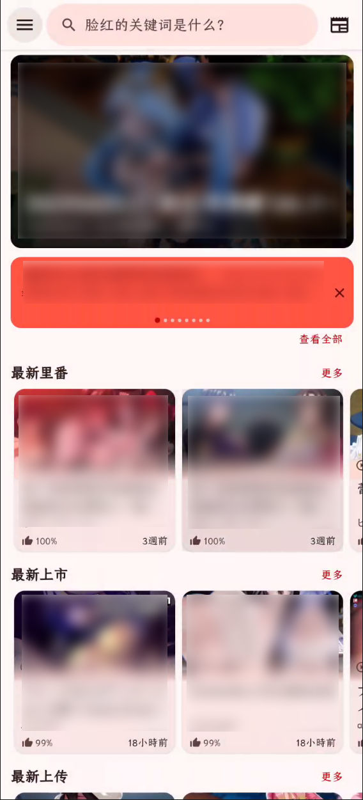</td>
    <td></td>
  </tr>
  <tr>
    <td>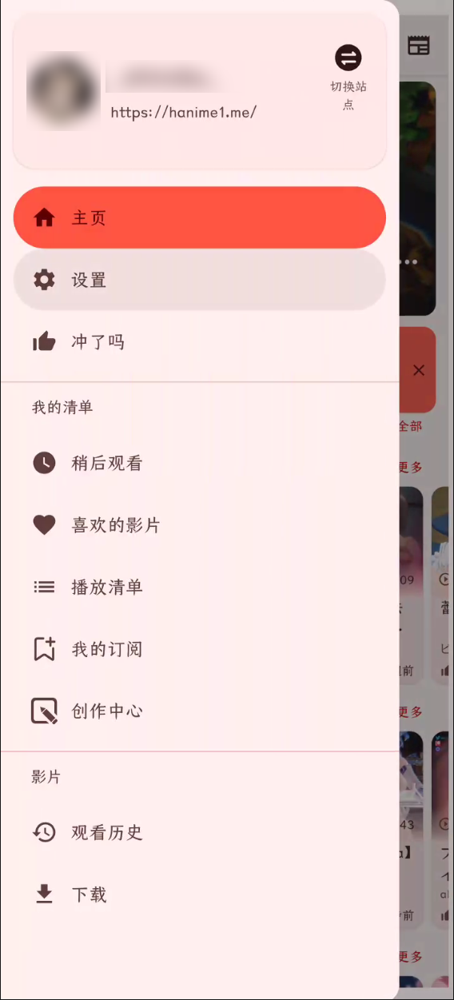</td>
    <td>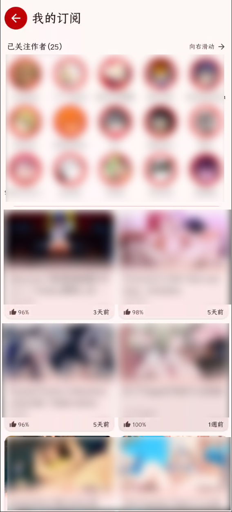</td>
    <td>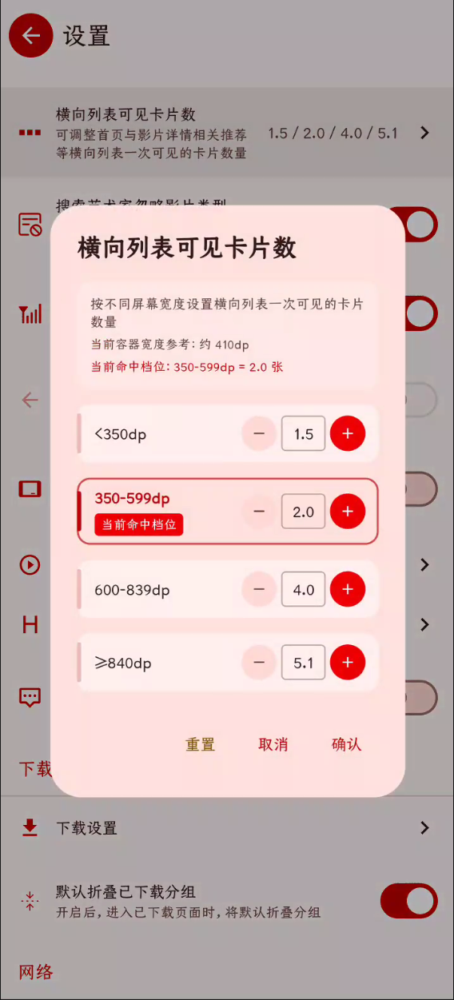</td>
  </tr>
  <tr>
    <td>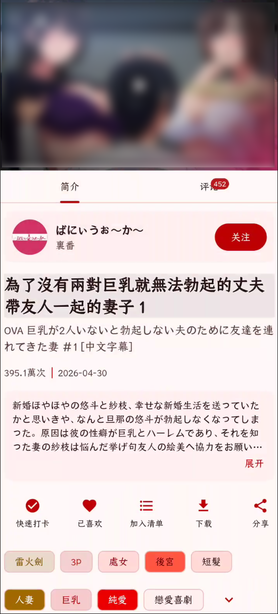</td>
    <td>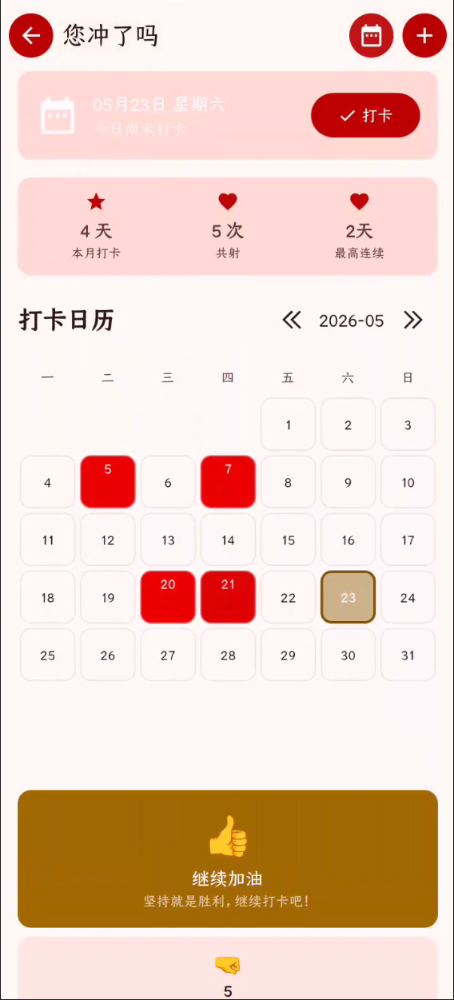</td>
    <td></td>
  </tr>
</table>

## 🧱 Current Architecture

📦 The project uses a multi-module Gradle structure:

- `:app`: the main app module, containing UI, navigation, business ViewModels, network parsing, database, download workers, players and resources.
- `:yenaly_libs`: the in-project common library, wrapping common Activities, Fragments, ViewModels, preferences, utilities and base components.
- `buildSrc`: build configuration helper code for Gradle logic such as version numbers, build types and commit information.

🗂️ The main app is organized in layers:

- `ui.activity`: entry Activity, login, Cloudflare handling and manual cookie input pages.
- `ui.navigation`: Navigation Compose route definitions, main navigation, settings navigation and safe navigation wrappers.
- `ui.screen`: Compose screen implementations, split by business area such as home, search, video, settings, account and downloads.
- `ui.component`: reusable Compose components such as video cards, dialogs, empty/error/loading states, app bars and comment cards.
- `ui.viewmodel`: page state and business action entry points, exposing state to the UI mainly through `StateFlow` / `SharedFlow`.
- `logic.network`: Retrofit services, OkHttp interceptors, DNS, CookieJar, the update service and the network entry point.
- `logic.model`: domain models produced by pages and network parsing, such as `HanimeVideo`, `HanimeInfo`, `HomePage` and `Playlists`.
- `logic.dao` / `logic.entity`: Room database, DAOs and entities for local data such as history, downloads, search history, key frames and check-ins.
- `announcement` pipeline: announcement data is read from the `announcements` node of Firebase Realtime Database, the home page fetches and shows it through `MainViewModel.loadAnnouncements()`, and the admin side maintains it with `HanimeAnnouncementManagerWebUI`.
- `worker`: WorkManager download tasks and update tasks (`HUpdateWorker`).
- `logic.network.HUpdater` / `HDeltaUpdater`: update checks, full APK download and incremental patch application; `util.Bspatch` is a pure Kotlin bspatch implementation.
- `util.install`: install methods (`ApkInstallMethod`), the foreground install service `ApkInstallService`, and the PackageInstaller / Shizuku installers.
- `shizuku` (with `src/main/aidl`): `ShellInterface`, which runs inside the Shizuku process and submits install sessions with shell permission.
- `util`: utilities for themes, network, files, permissions, cookies, toasts, video and general helpers.

🔁 Overall data flow:

```text
Compose Screen -> ViewModel -> NetworkRepo / DatabaseRepo -> Retrofit + Jsoup / Room -> StateFlow -> Compose Screen
```

🎞️ Video page data flow:

```text
VideoRoute -> VideoViewModel -> NetworkRepo.getHanimeVideo -> Parser -> HanimeVideo -> VideoScreen / Player / CommentScreen
```

🔄 Update data flow:

```text
HUpdater checks for updates -> HUpdateWorker -> (HDeltaUpdater delta rebuild | full APK download) -> installApkPackage -> system installer / ApkInstallService (PackageInstaller | Shizuku)
```

📥 Download data flow:

```text
DownloadScreen -> DownloadViewModel -> HanimeDownloadManagerV2 -> WorkManager Worker -> Room -> Flow -> UI
```

## 🛠️ Tech Stack

- Kotlin 2.4.x
- Java 21 toolchain
- Android Gradle Plugin 9.3.x
- Jetpack Compose + Material 3
- Navigation Compose + Kotlin Serialization typed routes
- ViewModel + StateFlow + SharedFlow
- Retrofit 3 + kotlinx.serialization converter
- Jsoup HTML parsing
- Room + KSP
- WorkManager background tasks
- Coil 3 Compose image loading
- Media3 ExoPlayer, JZVD, MPV Android
- Firebase Analytics, Crashlytics, Performance, Remote Config, Realtime Database
- AndroidX Window, Biometric, SplashScreen, Preference
- Apache Commons Compress (bzip2, used to decompress incremental patches)
- Shizuku API / Provider (silent install)
- AboutLibraries open-source license display

## 🧰 Build Environment

✅ Recommended environment:

- Android Studio Panda or newer.
- JDK 21.
- The Gradle Wrapper version bundled in the repository.
- Compile SDK: `37`.
- Minimum supported: Android 8.1, API `27`.
- Target SDK: `37`.

⚡ Build optimizations (`gradle.properties`):

- `org.gradle.caching`, `org.gradle.parallel`, `org.gradle.daemon` and `kotlin.incremental` are enabled, and `org.gradle.jvmargs` is `-Xmx3g -XX:MaxMetaspaceSize=1g`.
- `org.gradle.configuration-cache` is not enabled by default (the build script reads environment variables and runs git commands at configuration time). Enable it only after confirming compatibility.

📌 Key versions follow the repository files:

- `gradle.properties`
- `gradle/libs.versions.toml`
- `app/build.gradle.kts`
- `buildSrc/src/main/java/Config.kt`

## 🚀 Running Locally

1. Clone the project:

   ```bash
   git clone https://github.com/lwprfs/HANiEX.git
   ```

2. Open the project root in Android Studio.

3. Wait for Gradle Sync to finish.

4. Select the `debug` variant and run it on a device or emulator.

💻 Common commands:

```bash
./gradlew :app:compileDebugKotlin
./gradlew :app:assembleDebug
```

🪟 Windows PowerShell:

```powershell
.\gradlew.bat :app:compileDebugKotlin
.\gradlew.bat :app:assembleDebug
```

🔥 Firebase: put `google-services.json` in the `app/` directory (this file is ignored by `.gitignore`, and CI generates it from a secret). It must contain the app that matches the `applicationId`: `com.yenaly.hani.extended` for release. Debug builds add the `.debug` suffix (`com.yenaly.hani.extended.debug`), so you need to add that app in Firebase as well, otherwise the debug build fails because no matching client is found.

🔏 Release builds need signing configuration provided locally or by CI:

- Keystore file: `$HOME/.android/keystore.jks`
- Environment variables: `KEYSTORE_PASSWORD` (also used as the key password) and `KEY_ALIAS`
- Release packages only `arm64-v8a`, and the output file is named `HANiEX-v<versionName>.apk`

🔑 The GitHub API token can be provided through an environment variable or a local file:

- Environment variable: `HA_GITHUB_TOKEN`
- Local file: `app/ha1_github_token.txt`

## 🤖 CI and Releases

The workflow is at `.github/workflows/ci.yml` and runs on pushes to `main` (changes to `*.md` are ignored):

1. Check out the code, set up JDK 21, and configure Gradle caching through `gradle/actions/setup-gradle` (`cache-provider: basic`).
2. Generate `google-services.json` and the signing keystore from secrets, then run `./gradlew assembleRelease --build-cache --parallel`.
3. Find the last successful build, download its APK and generate an incremental patch (skipped automatically if this fails or the patch is not worthwhile, without affecting the main flow).
4. Upload the build artifacts: `app-release-<sha>` (full APK) and `delta-<sha>-base-<hash>` (incremental patch, if any).
5. When the commit message contains `[release]`, also generate release notes, diff against the previous release for an incremental patch, and create a GitHub Release (with the APK and the patch zip).

⚡ Cache behavior: the first run downloads dependencies and writes the cache; later runs reuse the cache and reusable build outputs, which shortens build time. The cache is only written on the `main` branch. GitHub removes caches that go unused for a long time or exceed the repository size limit, and the first run after that rebuilds the cache.

🔐 Secrets to configure:

- `GOOGLE_SERVICES_JSON_BASE64`: Base64 of `google-services.json`.
- `KEYSTORE_BASE64`, `KEYSTORE_PASSWORD`, `KEY_ALIAS`: the signing keystore, its password and alias.
- `HA_GITHUB_TOKEN`: the token the in-app updater uses to read GitHub build artifacts (written into `BuildConfig`).
- `APP_TOKEN`: the token used to create GitHub Releases.

Incremental patches are produced by `.github/scripts/make-delta.sh` (requires `bsdiff` and `jq`).

## ✅ Code Conventions

- Prefer Jetpack Compose for UI. A few legacy pages and components still use XML / ViewBinding / DataBinding.
- Expose page state through `StateFlow`, and pass events through `SharedFlow` or callbacks.
- When appending to network page lists, deduplicate by a stable business key to avoid Compose `Lazy*` list key conflicts.
- When using stable keys in `LazyColumn`, `LazyVerticalGrid` and `LazyRow`, make sure the data source is unique.

## 🗺️ Directory Overview

```text
HANiEX/                          Repository root
├── .github/
│   ├── workflows/ci.yml          CI: build, cache, incremental patches, release
│   └── scripts/make-delta.sh     Generates bsdiff incremental patch packages
├── app/                         Main Android app
│   ├── src/main/java/.../logic   Network, parsing, models, database, state
│   ├── src/main/java/.../ui      Activities, Compose screens, navigation, components, ViewModels
│   ├── src/main/java/.../util    Utilities (including install/ install methods, Bspatch)
│   ├── src/main/java/.../shizuku ShellInterface used by the Shizuku install method
│   ├── src/main/aidl             IShellInterface (Shizuku)
│   ├── src/main/java/.../worker  WorkManager tasks
│   └── src/main/res              Resources, themes, layouts, icons, widgets
├── yenaly_libs/                  In-project common library
├── buildSrc/                     Gradle build helper code
├── gradle/libs.versions.toml     Dependency version catalog
├── README.md                     Project description (Chinese)
├── README-en.md                  Project description (English)
└── README_TECH.md                Historical technical notes and some implementation notes
```

## 🤝 Contributing

- Before submitting code, make sure it passes `:app:compileDebugKotlin`.
- When changing network lists, paging or Compose `Lazy*` lists, check for duplicate key risks.
- When changing playback, download, account, cookie, Cloudflare or update logic, please describe how you verified it.
- When changing update or install logic, also check the Release channel, the CI channel, the incremental update fallback and all three install methods.
- To submit shared key H frames, see `.github/PULL_REQUEST_TEMPLATE/submit_h_keyframe.md`.

## 🧩 TODO

- Write ideas down whenever they come up.

## 📄 License

This project inherits the original project's [Apache License 2.0](https://www.apache.org/licenses/LICENSE-2.0). The main terms include:

- Commercial use, modification and distribution are allowed.
- The copyright notice and the license file must be retained.
- A description of modifications must be provided.
- No warranty of quality is provided.
- No liability is accepted for the user's use.

See the [LICENSE](LICENSE) file in the project root for the full terms.
